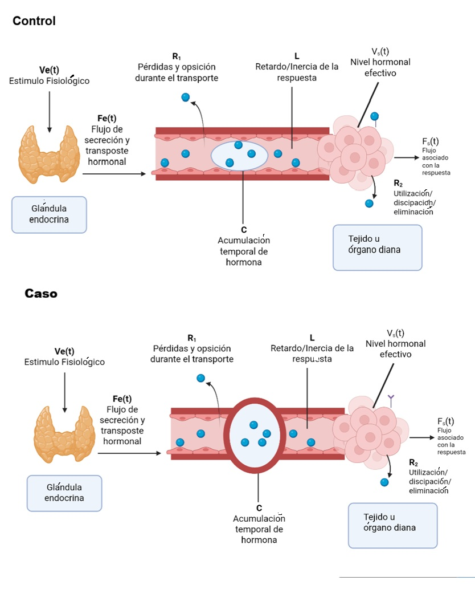
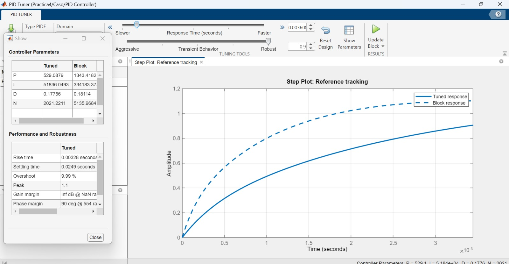
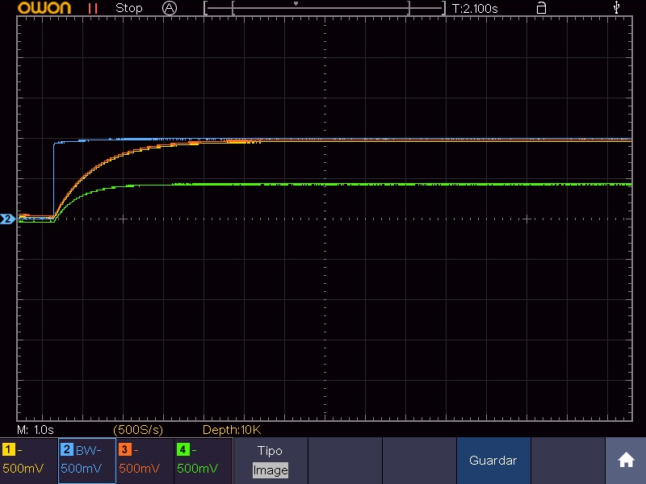
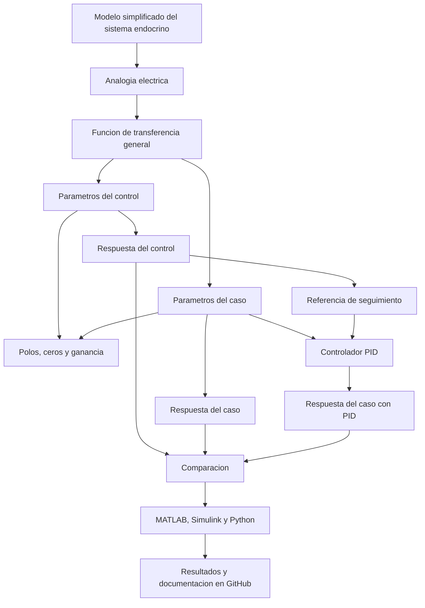

[](https://matlab.mathworks.com/open/github/v1?repo=l23212219-bot/MSFP4)

# Práctica 4 — Modelado y control del sistema endocrino

Repositorio académico de la asignatura **Modelado de Sistemas Fisiológicos**, del programa de **Ingeniería Biomédica** del Tecnológico Nacional de México / Instituto Tecnológico de Tijuana. La práctica utiliza una **analogía eléctrica de segundo orden** para comparar una condición de **control** y un **caso** del sistema endocrino, analizar sus respuestas y aplicar un controlador PID con retroalimentación negativa.

La formulación se comprueba mediante análisis matemático, MATLAB/Simulink y Python. Se incluyen además una representación fisiológica elaborada en BioRender, una evidencia de laboratorio y las figuras de resultados.

> **Alcance:** los términos *control* y *caso* identifican dos conjuntos de parámetros de un modelo equivalente. Los resultados no representan mediciones hormonales de pacientes ni permiten identificar, por sí solos, una enfermedad endocrina.

**Estudiante:** Navarro Rodríguez Sergio Andree  
**Número de control:** 23212219  
**Correo del estudiante:** l23212219@tijuana.tecnm.mx  
**Docente:** Dr. Paul Antonio Valle Trujillo  
**Correo del docente:** paul.valle@tectijuana.edu.mx  
**Asignatura:** Modelado de Sistemas Fisiológicos (IBF-1020)  
**Programa académico:** Ingeniería Biomédica  
**Departamento:** Ingeniería Eléctrica y Electrónica  
**Institución:** Tecnológico Nacional de México / Instituto Tecnológico de Tijuana  
**Repositorio de la práctica:** https://github.com/l23212219-bot/MSFP4  
**Repositorio de la asignatura:** https://github.com/DrPaulValle/MSF-IBF1020  
**Sede:** Blvd. Alberto Limón Padilla s/n, Tijuana, C. P. 22454, Baja California, México.

---

<a id="contenido"></a>
## Contenido

1. [Resumen](#resumen)
2. [Competencia y objetivos](#objetivos)
3. [Fundamento fisiológico y alcance del modelo](#fundamento)
4. [Analogía eléctrica y parámetros](#analogia)
5. [Formulación matemática](#modelo)
6. [Análisis de polos, ceros y respuesta temporal](#analisis)
7. [Señal de entrada y condiciones de simulación](#senal)
8. [Diseño del controlador PID](#pid)
9. [Implementación en MATLAB y Simulink](#matlab)
10. [Reproducción en Python](#python)
11. [BioRender y evidencia de laboratorio](#evidencias)
12. [Resultados y discusión](#resultados)
13. [Flujo de trabajo](#flujo)
14. [Estructura del repositorio](#estructura)
15. [Requisitos e instrucciones de ejecución](#requisitos)
16. [Reproducibilidad y criterios de revisión](#reproducibilidad)
17. [Conclusiones](#conclusiones)
18. [Referencias](#referencias)

---

<a id="resumen"></a>
## Resumen

El sistema endocrino regula procesos fisiológicos mediante la secreción y acción de hormonas. Para estudiar de manera simplificada el comportamiento dinámico de un sistema regulado, se utiliza una analogía eléctrica descrita por una función de transferencia de segundo orden. La práctica compara dos condiciones, denominadas **control** y **caso**, que utilizan la misma estructura matemática pero diferentes valores de componentes.

A partir de los parámetros del modelo se obtienen las funciones de transferencia, los polos, los ceros y la ganancia estática de cada condición. Se aplica una entrada escalón unitario y se comparan las respuestas en lazo abierto. Después se incorpora un **controlador PID** al modelo del caso, utilizando como referencia la respuesta del control. Las simulaciones se reproducen en MATLAB/Simulink y Python y se documentan mediante figuras, análisis matemático y material gráfico complementario.

La comparación permite estudiar el efecto de los parámetros sobre la dinámica del sistema, así como el cambio de respuesta cuando se introduce retroalimentación. Las magnitudes eléctricas se utilizan como variables de una **representación análoga**, no como conversiones directas de concentraciones hormonales.

**Palabras clave:** sistema endocrino; modelado de sistemas fisiológicos; analogía eléctrica; circuito RLC; función de transferencia; sistemas dinámicos de segundo orden; control y caso; controlador PID; retroalimentación negativa; MATLAB; Simulink; Python; BioRender.

[Volver al contenido](#contenido)

---

<a id="objetivos"></a>
## Competencia y objetivos

### Competencia a desarrollar

Aplicar los principios de modelado matemático y control de sistemas dinámicos para representar, simular e interpretar el comportamiento de un sistema fisiológico simplificado, mediante funciones de transferencia, analogías eléctricas y herramientas computacionales.

### Objetivo general

Modelar y comparar las respuestas de las condiciones control y caso del sistema endocrino, e implementar un controlador PID que permita modificar la respuesta del caso para aproximarla a la referencia establecida por el control.

### Objetivos específicos

- Identificar las variables de entrada, salida y los componentes equivalentes del modelo.
- Obtener y evaluar las funciones de transferencia de control y caso.
- Analizar las ecuaciones diferenciales, polos, ceros, ganancia estática y estabilidad.
- Comparar las respuestas de ambos modelos ante una misma entrada escalón.
- Implementar el sistema y el controlador en MATLAB/Simulink.
- Reproducir numéricamente los resultados en Python.
- Interpretar el efecto de la retroalimentación y documentar las evidencias disponibles.

[Volver al contenido](#contenido)

---

<a id="fundamento"></a>
## Fundamento fisiológico y alcance del modelo

El sistema endocrino está integrado por glándulas y tejidos que liberan hormonas. Sus mecanismos de regulación dependen de señales, respuestas de los tejidos y procesos de retroalimentación que contribuyen al mantenimiento de la homeostasis. La **retroalimentación negativa** es un concepto central tanto en regulación endocrina como en ingeniería de control: una salida se compara con una referencia para producir una acción correctiva.

En esta práctica se emplean dos conjuntos de parámetros:

| Condición | Significado dentro del trabajo |
|---|---|
| **Control** | Modelo de referencia frente al que se compara la respuesta. |
| **Caso** | Modelo con valores eléctricos modificados y una respuesta distinta. |
| **Caso con PID** | Modelo del caso con retroalimentación negativa cuyo objetivo es seguir la salida del control. |

**Importante:** la analogía no define una hormona específica, una glándula concreta ni una patología diagnosticada. Por tanto, no se debe afirmar que la alteración del capacitor o de la resistencia represente una enfermedad determinada sin una justificación fisiológica adicional.

### Representación gráfica



*Figura 1. Representación gráfica del sistema endocrino incluida en el repositorio. Su función es complementar la explicación fisiológica; el modelo matemático se define por sus ecuaciones y parámetros eléctricos.*

[Volver al contenido](#contenido)

---

<a id="analogia"></a>
## Analogía eléctrica y parámetros

Se utiliza un circuito equivalente con dos resistencias, una inductancia y una capacitancia. Las variables eléctricas permiten construir una relación entrada–salida para estudiar cómo responde el sistema frente a una señal aplicada.

| Símbolo | Interpretación en el modelo | Unidad eléctrica |
|---|---|---|
| $V_e(t)$ | Señal de entrada aplicada | V |
| $V_s(t)$ | Señal de salida del modelo | V |
| $R_1$, $R_2$ | Resistencias del circuito equivalente | $\Omega$ |
| $L$ | Inductancia del circuito equivalente | H |
| $C$ | Capacitancia del circuito equivalente | F |
| $s$ | Variable compleja de Laplace | $\mathrm{s}^{-1}$ |

### Valores utilizados

Los parámetros siguientes están definidos en [`Navarro23212219.py`](Navarro23212219.py):

| Componente | Control | Caso |
|---|---:|---:|
| $R_1$ | $1\,000\ \Omega$ | $1\,000\ \Omega$ |
| $R_2$ | $100\,000\ \Omega$ | $1\,000\ \Omega$ |
| $L$ | $0.1\ \mathrm{H}$ | $0.1\ \mathrm{H}$ |
| $C$ | $1\times10^{-6}\ \mathrm{F}$ | $1\times10^{-3}\ \mathrm{F}$ |

La variación de $R_2$ y $C$ cambia los coeficientes del denominador y, en consecuencia, la dinámica y la ganancia estática del sistema.

[Volver al contenido](#contenido)

---

<a id="modelo"></a>
## Formulación matemática

### 1. Función de transferencia general

El modelo que construye la función `sis(C, R2, nombre)` del programa de Python es:

$$
\boxed{G(s)=\frac{V_s(s)}{V_e(s)}=\frac{Ls+R_2}{CLR_1s^2+(CR_1R_2+L)s+(R_1+R_2)}}
$$

Su denominador es de **segundo orden** y el numerador contiene un término de primer orden. Esta función describe la relación entre entrada y salida para condiciones iniciales nulas.

### 2. Ecuación diferencial equivalente

Al multiplicar por el denominador y regresar al dominio del tiempo se obtiene:

$$
\begin{aligned}
CLR_1\frac{d^2V_s(t)}{dt^2}
+ (CR_1R_2+L)\frac{dV_s(t)}{dt}
+ (R_1+R_2)V_s(t) \\
= L\frac{dV_e(t)}{dt}+R_2V_e(t).
\end{aligned}
$$

La ecuación representa una relación entre la entrada, su derivada y la evolución de la salida. La función de transferencia, por sí sola, no permite reconstruir de manera única la topología eléctrica sin consultar su diagrama de circuito.

### 3. Modelo de control

Sustituyendo $R_1=1000$, $R_2=100000$, $L=0.1$ y $C=10^{-6}$:

$$
\boxed{G_{control}(s)=\frac{0.1s+100000}{0.0001s^2+100.1s+101000}}
$$

La ecuación diferencial asociada es:

$$
0.0001\,\ddot V_{s,c}(t)+100.1\,\dot V_{s,c}(t)+101000\,V_{s,c}(t)
=0.1\,\dot V_e(t)+100000\,V_e(t).
$$

### 4. Modelo del caso

Sustituyendo $R_1=1000$, $R_2=1000$, $L=0.1$ y $C=10^{-3}$:

$$
\boxed{G_{caso}(s)=\frac{0.1s+1000}{0.1s^2+1000.1s+2000}}
$$

La ecuación diferencial correspondiente es:

$$
0.1\,\ddot V_{s,k}(t)+1000.1\,\dot V_{s,k}(t)+2000\,V_{s,k}(t)
=0.1\,\dot V_e(t)+1000\,V_e(t).
$$

### 5. Expresión integro-diferencial

Una representación equivalente se obtiene integrando una vez la ecuación diferencial general desde $0$ hasta $t$. Para estados iniciales nulos:

$$
CLR_1\frac{dV_s(t)}{dt}
+(CR_1R_2+L)V_s(t)
+(R_1+R_2)\int_0^t V_s(\tau)\,d\tau
=LV_e(t)+R_2\int_0^t V_e(\tau)\,d\tau.
$$

Esta forma puede utilizarse para razonar sobre una implementación con integradores en Simulink. Para estados iniciales distintos de cero deben incorporarse los términos iniciales correspondientes.

[Volver al contenido](#contenido)

---

<a id="analisis"></a>
## Análisis de polos, ceros y respuesta temporal

### 1. Ganancia estática

Evaluando cada modelo en $s=0$:

$$
G(0)=\frac{R_2}{R_1+R_2}.
$$

Para el control:

$$
\boxed{G_{control}(0)=\frac{100000}{101000}\approx0.990099}
$$

Para el caso:

$$
\boxed{G_{caso}(0)=\frac{1000}{2000}=0.5}
$$

En consecuencia, ante un escalón unitario mantenido y con estabilidad, el valor final de la salida es aproximadamente **0.9901 V para control** y **0.5 V para caso**.

### 2. Polos y ceros

Los polos se calculan como raíces del denominador:

$$
CLR_1s^2+(CR_1R_2+L)s+(R_1+R_2)=0.
$$

Su solución general es:

$$
\boxed{s_{1,2}=\frac{-(CR_1R_2+L)\pm\sqrt{(CR_1R_2+L)^2-4CLR_1(R_1+R_2)}}{2CLR_1}}
$$

El cero del numerador se obtiene de $Ls+R_2=0$:

$$
\boxed{z=-\frac{R_2}{L}}.
$$

| Propiedad | Control | Caso |
|---|---:|---:|
| Polo 1 (aprox.) | $-1010.0101\ \mathrm{s}^{-1}$ | $-2.0002\ \mathrm{s}^{-1}$ |
| Polo 2 (aprox.) | $-999989.9899\ \mathrm{s}^{-1}$ | $-9998.9998\ \mathrm{s}^{-1}$ |
| Cero | $-1000000\ \mathrm{s}^{-1}$ | $-10000\ \mathrm{s}^{-1}$ |
| Ganancia estática | $0.990099$ | $0.5$ |

Ambos modelos poseen polos reales negativos, por lo que son **estables en lazo abierto**. El polo dominante del caso tiene menor magnitud que el del control y produce una evolución más lenta de la respuesta. La magnitud de los polos rápidos también exige considerar la resolución temporal y la configuración del solucionador.

### 3. Interpretación de las diferencias

El modelo de control llega rápidamente a un valor cercano a la amplitud de la entrada. El modelo del caso, además de presentar una ganancia estática menor, conserva una dinámica más lenta. Estas diferencias se deben a los parámetros eléctricos empleados y no deben interpretarse como tiempos de respuesta hormonales medidos en un organismo.

[Volver al contenido](#contenido)

---

<a id="senal"></a>
## Señal de entrada y condiciones de simulación

El programa de Python utiliza los parámetros siguientes:

| Parámetro | Valor |
|---|---:|
| Tiempo inicial | $0\ \mathrm{s}$ |
| Tiempo final | $10\ \mathrm{s}$ |
| Intervalo temporal | $0.001\ \mathrm{s}$ |
| Número de muestras | $10001$ |
| Condición inicial de la simulación | $0$ |
| Entrada | Escalón unitario desde $t=0$ |

La señal se define como:

$$
V_e(t)=1,\qquad 0\leq t\leq10\ \mathrm{s}.
$$

En Python se construye con `u = np.ones(N)` y la simulación se realiza mediante `control.forced_response`. Esta configuración permite comparar las tres respuestas con el mismo eje temporal.

[Volver al contenido](#contenido)

---

<a id="pid"></a>
## Diseño del controlador PID

### 1. Objetivo del control

El sistema de control utiliza como **referencia la salida del modelo de control**. Esa señal se aplica al sistema formado por el controlador PID y el modelo del caso en lazo cerrado. Por tanto, el objetivo es aproximar la respuesta del caso a $V_{s,control}(t)$, no simplemente obligarlo a seguir directamente el escalón de entrada.

La función de transferencia de lazo cerrado con retroalimentación negativa unitaria es:

$$
\boxed{T(s)=\frac{C_{PID}(s)G_{caso}(s)}{1+C_{PID}(s)G_{caso}(s)}}.
$$

La respuesta controlada utilizada en el programa cumple:

$$
V_{tratamiento}(s)=T(s)\,V_{s,control}(s).
$$

### 2. Valores introducidos en el programa

| Parámetro | Valor |
|---|---:|
| `kP` | $13209.9564$ |
| `kI` | $32316525.9285$ |
| `kD` | $0.18118$ |
| `Cr` | $1\times10^{-6}\ \mathrm{F}$ |

El script calcula otros tres componentes equivalentes:

$$
R_e=\frac{1}{C_rk_I},\qquad R_r=k_PR_e,\qquad C_e=\frac{k_D}{R_r}.
$$

Sustituyendo los valores se obtiene aproximadamente:

| Componente equivalente | Valor calculado |
|---|---:|
| $R_e$ | $0.0309439\ \Omega$ |
| $R_r$ | $408.7678\ \Omega$ |
| $C_e$ | $4.43234\times10^{-4}\ \mathrm{F}$ ($443.234\ \mu\mathrm{F}$) |

Estos valores resultan de la **parametrización algebraica del código**. No se afirma que sean los componentes realmente montados en el laboratorio.

### 3. Función de transferencia implementada

El controlador se construye mediante:

$$
\boxed{C_{PID}(s)=\frac{R_eR_rC_eC_rs^2+(R_eC_e+R_rC_r)s+1}{R_eC_rs}}
$$

Dividiendo cada término:

$$
C_{PID}(s)=R_rC_es+\left(\frac{C_e}{C_r}+\frac{R_r}{R_e}\right)+\frac{1}{R_eC_rs}.
$$

Es decir, equivale a una estructura ideal de acciones proporcional, integral y derivativa:

$$
C_{PID}(s)=K_D^{ef}s+K_P^{ef}+\frac{K_I^{ef}}{s},
$$

con:

$$
K_D^{ef}=k_D,\quad K_I^{ef}=k_I,\quad
\boxed{K_P^{ef}=k_P+\frac{C_e}{C_r}\approx13653.1909}.
$$

**Precisión importante:** el coeficiente proporcional efectivo de la función de transferencia no es exactamente el parámetro `kP` del script, debido al término adicional $C_e/C_r$. El README conserva esta distinción para describir la implementación de forma fiel.

### 4. Interpretación

- La acción **proporcional** responde al error instantáneo.
- La acción **integral** acumula el error y contribuye a disminuir el error de seguimiento en régimen permanente, siempre que el sistema controlado sea estable.
- La acción **derivativa** responde a la tasa de cambio del error y modifica la dinámica transitoria.

No se reportan porcentajes de sobreimpulso ni tiempos de establecimiento medidos porque esos valores requieren analizar las respuestas efectivamente obtenidas; tampoco se supone que exista una equivalencia exacta entre el controlador matemático y un circuito físico montado.



*Figura 2. Evidencia de parámetros de sintonización del controlador incluida en el repositorio.*

[Volver al contenido](#contenido)

---

<a id="matlab"></a>
## Implementación en MATLAB y Simulink

El repositorio incluye el cuaderno MATLAB, el modelo de Simulink y los documentos de resultados:

| Archivo | Función |
|---|---|
| [`Navarro23212219.mlx`](Navarro23212219.mlx) | Desarrollo y ejecución desde MATLAB Live Editor. |
| [`SIS4.slx`](SIS4.slx) | Modelo de simulación en Simulink. |
| [`Navarro23212219.pdf`](Navarro23212219.pdf) | Exportación del cuaderno de trabajo. |
| [`Control y caso.matlab.pdf`](Control%20y%20caso.matlab.pdf) | Resultados comparativos exportados de MATLAB. |
| [`Analisis-Matematico.pdf`](Analisis-Matematico.pdf) | Documento del análisis matemático. |

### Procedimiento general

1. Abrir `SIS4.slx` en Simulink y revisar los bloques y sus parámetros.
2. Abrir `Navarro23212219.mlx` en MATLAB.
3. Verificar los valores de componentes, las condiciones iniciales y la entrada aplicada.
4. Ejecutar el modelo y observar las respuestas del control, del caso y del caso con PID.
5. Comparar las curvas con el análisis de las funciones de transferencia.
6. Consultar las figuras exportadas y conservar los resultados junto al modelo.

Para reproducir resultados de la misma forma en MATLAB y Python se deben usar **los mismos coeficientes, la misma referencia de lazo cerrado y las mismas condiciones iniciales**. Las configuraciones exactas del archivo `.slx` deben verificarse al abrirlo; no se presuponen conexiones o bloques no inspeccionados aquí.

**Resultados en MATLAB:** [Consultar gráfica en PDF](Control%20y%20caso.matlab.pdf).

[Volver al contenido](#contenido)

---

<a id="python"></a>
## Reproducción en Python

El programa [`Navarro23212219.py`](Navarro23212219.py) utiliza **NumPy**, **python-control** y **Matplotlib** para simular los modelos y construir una figura comparativa.

### Bibliotecas utilizadas

```python
import numpy as np
import control as ctrl
import matplotlib.pyplot as plt
```

El script también importa `math`, aunque ese módulo no interviene en las operaciones principales mostradas.

### Definición de la función de transferencia

```python
def sis(C, R2, nombre):
    R1, L = 1E3, 100E-3
    num = [L, R2]
    den = [C*L*R1, C*R1*R2+L, R1+R2]
    sys = ctrl.tf(num, den)
    return sys

sysControl = sis(1E-6, 100E3, "Control")
sysCaso = sis(1000E-6, 1E3, "Caso")
```

### Construcción de la retroalimentación

```python
PID = ctrl.tf(numPID, denPID)
sysPID = ctrl.feedback(ctrl.series(PID, sysCaso), 1, sign=-1)
```

### Obtención de las respuestas

```python
Control = openloop(t, sysControl, u)
Caso = openloop(t, sysCaso, u)
Tratamiento = closedloop(t, sysPID, Control)
```

**Observación:** `Tratamiento` recibe como entrada la señal `Control`, una diferencia importante frente a simular `sysPID` directamente con `u`.

El programa representa cuatro curvas:

| Señal del programa | Significado |
|---|---|
| `u` | Entrada escalón $V_e(t)$. |
| `Control` | Salida del modelo de control en lazo abierto. |
| `Caso` | Salida del modelo del caso en lazo abierto. |
| `Tratamiento` | Salida del caso con PID usando como referencia la respuesta del control. |

También se definen cuatro colores para distinguir las curvas y se guarda una figura con el nombre `Control_caso_python4.pdf`. En el repositorio, la evidencia publicada para los resultados de Python se llama [`Controlcasopython.pdf`](Controlcasopython.pdf); el archivo generado localmente puede renombrarse antes de subirlo si se desea mantener ese nombre.

**Resultados en Python:** [Consultar gráfica en PDF](Controlcasopython.pdf).

[Volver al contenido](#contenido)

---

<a id="evidencias"></a>
## BioRender y evidencia de laboratorio

### Representación fisiológica

El archivo [`Biorender.jpg`](Biorender.jpg) presenta el recurso gráfico desarrollado para ilustrar el sistema endocrino. Se utiliza como apoyo para relacionar el tema fisiológico con el estudio de regulación y retroalimentación.

### Evidencia experimental



*Figura 3. Imagen de laboratorio incluida en el repositorio.*

El registro de laboratorio complementa la documentación de la práctica, pero **una fotografía no basta para establecer** los valores de los componentes, el procedimiento de medición, la respuesta de un osciloscopio o la validación física completa del PID. Tales afirmaciones requieren datos o registros experimentales identificables.

[Volver al contenido](#contenido)

---

<a id="resultados"></a>
## Resultados y discusión

### Evidencias publicadas

| Evidencia | Archivo |
|---|---|
| Análisis matemático | [`Analisis-Matematico.pdf`](Analisis-Matematico.pdf) |
| Resultados de MATLAB | [`Control y caso.matlab.pdf`](Control%20y%20caso.matlab.pdf) |
| Resultados de Python | [`Controlcasopython.pdf`](Controlcasopython.pdf) |
| Cuaderno MATLAB exportado | [`Navarro23212219.pdf`](Navarro23212219.pdf) |
| Parámetros de PID | [`ParametrosPID.jpeg`](ParametrosPID.jpeg) |
| BioRender | [`Biorender.jpg`](Biorender.jpg) |
| Laboratorio | [`Laboratorio.jpeg`](Laboratorio.jpeg) |

### Comparación de comportamientos

1. **Control:** su ganancia estática próxima a la unidad y sus polos negativos de elevada magnitud producen una respuesta rápida frente al escalón.
2. **Caso:** alcanza un valor final de 0.5 frente a una entrada unitaria y su polo dominante cercano a $-2\ \mathrm{s}^{-1}$ representa una dinámica más lenta.
3. **Caso con PID:** el controlador busca que la respuesta del caso siga la salida del control. Para valorar el grado de seguimiento deben contrastarse las curvas exportadas y, de ser necesario, calcularse métricas de error.
4. **Comparación entre herramientas:** MATLAB y Python permiten revisar la consistencia de las representaciones si se mantienen parámetros, condiciones iniciales, tiempos y topología de control equivalentes.

No se atribuyen errores porcentuales, tiempos de establecimiento ni valores máximos a las figuras sin su medición directa. Esta sección distingue las **predicciones derivadas de las funciones de transferencia** de los **resultados gráficos disponibles**.

[Volver al contenido](#contenido)

---

<a id="flujo"></a>
## Flujo de trabajo



[Volver al contenido](#contenido)

---

<a id="estructura"></a>
## Estructura del repositorio

Estructura identificada en la rama `main` del repositorio al preparar este README:

```text
MSFP4/
├── Analisis-Matematico.pdf
├── Biorender.jpg
├── Control y caso.matlab.pdf
├── Controlcasopython.pdf
├── Laboratorio.jpeg
├── LICENSE
├── Navarro23212219.mlx
├── Navarro23212219.pdf
├── Navarro23212219.py
├── ParametrosPID.jpeg
├── README.md
└── SIS4.slx
```

Los nombres conservan las mayúsculas, espacios y extensiones que aparecen en GitHub, para que los enlaces relativos funcionen correctamente.

[Volver al contenido](#contenido)

---

<a id="requisitos"></a>
## Requisitos e instrucciones de ejecución

### Software

- **MATLAB R2023a** o una versión compatible con el archivo Live Script.
- **Simulink** para abrir `SIS4.slx`.
- **Control System Toolbox**, si se trabajan funciones como `tf`, `feedback` y análisis de polos desde MATLAB.
- **Python 3**, con las bibliotecas NumPy, Matplotlib y `control`.
- Un lector de PDF para consultar el análisis y las figuras exportadas.

> La versión MATLAB R2023a corresponde al entorno de trabajo utilizado para esta práctica; la compatibilidad definitiva depende de las funciones y bloques que contenga cada archivo.

### Ejecutar Python

Clonar el repositorio:

```bash
git clone https://github.com/l23212219-bot/MSFP4.git
cd MSFP4
```

Instalar dependencias:

```bash
python -m pip install numpy matplotlib control
```

Ejecutar el programa:

```bash
python Navarro23212219.py
```

Al ejecutarlo, se calculan las funciones de transferencia, el lazo cerrado y las respuestas. Se muestra la comparación gráfica y se guarda un PDF con el nombre que está especificado en el código.

### Ejecutar MATLAB/Simulink

1. Abrir MATLAB y establecer la carpeta `MSFP4` como directorio actual.
2. Abrir `SIS4.slx` y revisar la configuración del modelo.
3. Abrir `Navarro23212219.mlx`.
4. Ejecutar las secciones del cuaderno y comparar con los archivos PDF incluidos.

También se puede iniciar MATLAB Online desde el botón de la parte superior, sujeto a la disponibilidad de los productos requeridos en la cuenta.

[Volver al contenido](#contenido)

---

<a id="reproducibilidad"></a>
## Reproducibilidad y criterios de revisión

### Verificación matemática

- [x] Identificación de los valores $R_1$, $R_2$, $L$ y $C$ utilizados en Python.
- [x] Expresión de la función de transferencia general.
- [x] Sustitución de valores para control y caso.
- [x] Obtención analítica de polos, ceros y ganancias estáticas.
- [x] Identificación del controlador de retroalimentación en el programa.
- [x] Relación entre la salida del control y la referencia del PID.

### Archivos documentados

- [x] Código Python `.py`.
- [x] Cuaderno MATLAB `.mlx` y exportación `.pdf`.
- [x] Archivo de Simulink `.slx`.
- [x] Análisis matemático en PDF.
- [x] Figuras de MATLAB y Python en PDF.
- [x] Representación BioRender y fotografía de laboratorio.

### Comprobaciones adicionales para una validación experimental completa

- [ ] Registrar mediciones numéricas de laboratorio con sus unidades y condiciones de adquisición.
- [ ] Comparar cuantitativamente las respuestas simuladas con mediciones experimentales, cuando existan.
- [ ] Verificar físicamente los componentes del controlador si se pretende construir su realización analógica.
- [ ] Documentar métricas de seguimiento del PID, si las solicita el análisis de desempeño.

Estas comprobaciones adicionales no se presentan como resultados ya obtenidos. El análisis incluido corresponde a los datos y al código disponibles.

[Volver al contenido](#contenido)

---

<a id="conclusiones"></a>
## Conclusiones

La práctica permitió representar un sistema de regulación mediante funciones de transferencia de segundo orden y estudiar cómo cambia su respuesta cuando se modifican los valores de los componentes de una analogía eléctrica. Las condiciones de control y caso presentan diferencias tanto en ganancia estática como en rapidez de respuesta, lo que puede comprobarse mediante el análisis de polos y las simulaciones.

La incorporación del controlador PID permite estudiar el seguimiento de una respuesta de referencia utilizando retroalimentación negativa. En el programa empleado, la referencia corresponde a la salida del modelo de control, mientras que el controlador actúa sobre el modelo del caso. La documentación conjunta de MATLAB/Simulink y Python permite contrastar el procedimiento matemático y computacional.

Finalmente, la representación en BioRender y la evidencia de laboratorio complementan el trabajo. Es importante mantener la diferencia entre el **modelo teórico**, los **resultados de simulación** y la **validación experimental**, ya que una analogía eléctrica simplificada no reproduce por sí sola toda la complejidad fisiológica del sistema endocrino.

[Volver al contenido](#contenido)

---

<a id="referencias"></a>
## Referencias

[1] P. A. Valle Trujillo, *Material de la asignatura Modelado de Sistemas Fisiológicos*, Tecnológico Nacional de México / Instituto Tecnológico de Tijuana. [Repositorio académico de la asignatura](https://github.com/DrPaulValle/MSF-IBF1020).

[2] J. E. Hall, *Guyton and Hall Textbook of Medical Physiology*, 14.ª ed., Elsevier, 2021.

[3] K. Ogata, *Ingeniería de control moderna*, 5.ª ed., Pearson Educación, 2010.

[4] N. S. Nise, *Control Systems Engineering*, 8.ª ed., Wiley, 2020.

[5] MathWorks, *MATLAB and Simulink Documentation*. https://www.mathworks.com/help/

[6] Python Control Systems Library, *python-control Documentation*. https://python-control.readthedocs.io/

[7] *Práctica 4: Modelado y control del sistema endocrino*, repositorio académico MSFP4, 2026. https://github.com/l23212219-bot/MSFP4

---

## Uso académico y licencia

Este repositorio reúne documentos y simulaciones académicas elaborados para estudiar el modelado y control de un sistema fisiológico simplificado. Las ecuaciones y valores empleados corresponden a la implementación examinada; cualquier cambio en parámetros o topología debe documentarse para conservar la reproducibilidad.

El repositorio incluye el archivo [`LICENSE`](LICENSE), correspondiente a la licencia **BSD 2-Clause** indicada en GitHub. Los materiales de terceros conservan las condiciones de uso aplicables a sus respectivas fuentes.
